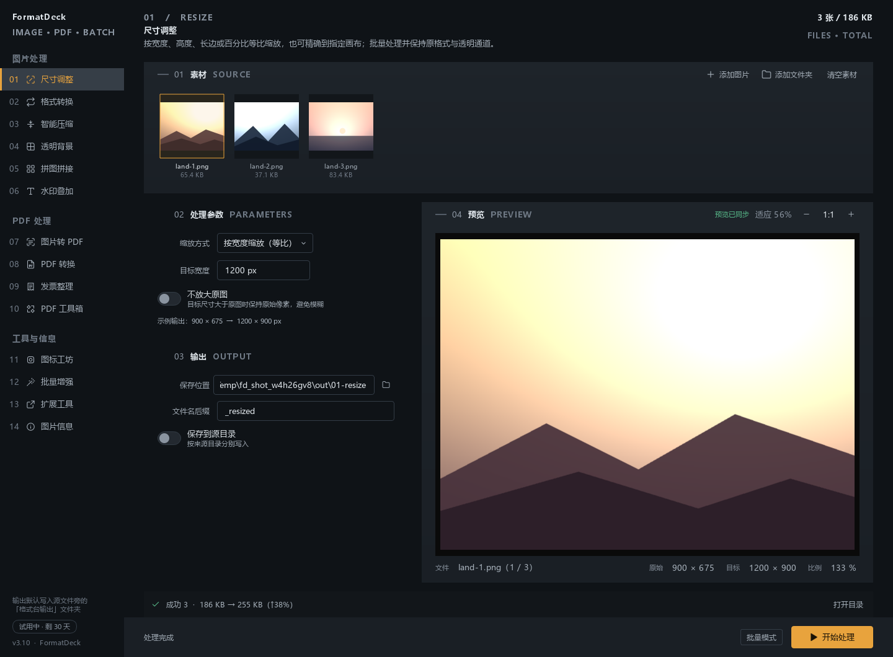

# FormatDeck 格式台

<p></p>

Windows 上的批量图片处理 + PDF 工具箱。一个 exe，14 个功能，全程本地运行。



---

## 为什么做这个

做电商的每天要改主图尺寸，做行政的要把发票拼版打印，做设计的要把
几十张图压到 500 KB 以内，交材料的要把手机拍的合同转成平整的 PDF。

这些事单拎出来都有工具，但每件事换一个软件、换一个网站，
文件还得往别人的服务器上传一遍。合同、发票、身份证扫描件上传到
来路不明的网站，是实打实的风险。

格式台把这些收进一个窗口，文件不出本机。

---

## 功能

| 功能 | 能做什么 |
|---|---|
| **尺寸调整** | 按宽/高/长边/百分比等比缩放，或精确指定画布；批量时保留原格式与透明通道 |
| **格式转换** | PNG / JPEG / WebP / AVIF / ICO / BMP / GIF / TIFF 互转，自动剥离 EXIF 与 GPS |
| **智能压缩** | 按质量压，或直接指定「压到 500 KB 以内」，超标自动降分辨率 |
| **透明背景** | 白底 / 纯色底 Logo、印章、商品图一键去底，边缘去白边不毛糙 |
| **拼图拼接** | 网格、横向长图、纵向瀑布长图；间距、圆角、背景色可调 |
| **水印叠加** | 文字或 Logo 水印，透明度、角度、九宫格位置、平铺密度可调 |
| **图片转 PDF** | 手机拍的材料自动找纸边、透视拉正、去桌面背景，输出像扫描件 |
| **PDF 转换** | PDF 转图片 / 提取文字 / 转可编辑 Word / 导出单文件 HTML |
| **发票整理** | 多张 PDF 发票裁白边、每页拼 2 张、加裁切线、直接打印省一半纸 |
| **PDF 工具箱** | 合并、拆分、提取指定页、压缩、加密、解除密码、旋转页面 |
| **图标工坊** | 一张图出整套图标：Windows .ico 多尺寸、favicon、iOS / Android / macOS 全套 |
| **批量增强** | 圆角、描边相框、任意角度旋转、翻转、九宫格切图、亮度对比度微调、清元数据 |
| **扩展工具** | 比例裁切（1:1 / 4:3 / 16:9）、图片打包成 PDF、GIF 合成与拆解 |
| **图片信息** | 尺寸、格式、帧数、EXIF 参数、主色板、亮度直方图 |

截图在 [`screenshots/`](screenshots/) 目录，每张对应一个功能。

---

## 下载

| 版本 | 系统 | 大小 |
|---|---|---|
| **v3.10** | Windows 10 / 11 · 64 位 | 94 MB |

- **蓝奏云**（推荐，国内直连、无需登录）：https://rsfxz.lanzoum.com/b01i60gbuj
  提取码 `0000`
- **GitHub Releases**：版本更新说明与历史记录（安装包统一放蓝奏云，不走 GitHub）

校验值：

```
SHA256  ec4b698aa093c6a87babb4c65116aa0b2b12e5eb2f72ab60748cf04d652fc2c3
```

---

## 怎么用

1. 解压到**纯英文路径**，例如 `D:\FormatDeck`
   （放到中文路径或桌面深层目录，个别功能可能读不到临时文件）
2. 双击 `FormatDeck.exe`
3. 左边选功能 → 中间拖进图片或 PDF → 右边设参数 → 点「开始」

不需要安装，不需要管理员权限，不需要联网。
不想用了直接删掉整个文件夹，不留注册表项、不留缓存。

---

## 第一次打开会弹「未知发布者」

程序没有购买代码签名证书，Windows SmartScreen 会拦一道，
显示「Windows 已保护你的电脑」。

点 **更多信息** → **仍要运行** 即可。

**杀软报毒怎么办**：PyInstaller 打包的程序被误报是行业常态
（打包器的引导代码长得像加壳程序）。把这个文件夹加进杀软白名单，
或者上传到 [VirusTotal](https://www.virustotal.com/) 自查。

---

## 使用

下载后解压，双击 `FormatDeck.exe` 即可。免安装、不写注册表、不需要联网。

功能建议或使用问题：**QQ 1394844764** / **1394844764@qq.com**

---

## 系统要求

- Windows 10 / 11，64 位
- 不需要 .NET、不需要 Python、不需要联网
- 关于本机的授权状态写在 `%LOCALAPPDATA%\FormatDeck\`，删掉即恢复试用

---

## 更新日志

见 [CHANGELOG.md](CHANGELOG.md)。

---

## 许可

专有软件。个人购买后可在自己的电脑上使用；
未经书面授权，不得反编译、二次分发、商业转售或打包进其他产品。
详见 [LICENSE.txt](LICENSE.txt)。
